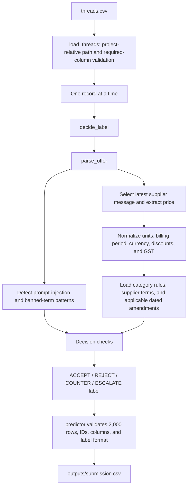

# The Procurement Desk

The Procurement Desk is a rule-based supplier negotiation assistant and Kaggle
submission pipeline. It reads negotiation threads, extracts and normalizes the
latest supplier offer, applies category and supplier terms from the procurement
playbook, and emits one decision label per thread. A Streamlit dashboard can run
the same decision function on demand and display its results in memory.

> **Decision support, not autonomous procurement.** The rules and parser are
> deterministic code; this project does not use a machine-learning model to
> make the decisions. Review escalations and validate the rules against current
> organizational policy before using this approach in a real procurement
> workflow.

## Table of contents

1. [Overview](#1-overview)
2. [Mathematics](#2-mathematics)
3. [Architecture](#3-architecture)
4. [Implementation](#4-implementation)
5. [AI models and APIs](#5-ai-models-and-apis)
6. [Tricky cases](#6-tricky-cases)
7. [Evaluation](#7-evaluation)
8. [Real-world application](#8-real-world-application)
9. [Drawbacks and limitations](#9-drawbacks-and-limitations)
10. [Original work and disclosures](#10-original-work-and-disclosures)
11. [How to run](#11-how-to-run)

## 1. Overview

For each row in [threads.csv](./threads.csv), the loader validates the required fields and
returns a pandas DataFrame. The decision engine parses the supplier message,
normalizes a usable offer to the category's INR price basis excluding GST, and
checks it against the applicable supplier and category rules. It returns one
label in the format `ACTION:REASON:COUNTER_PRICE`. The final field is populated
only for a `COUNTER` decision.

The four actions are:

| Action | Meaning in this implementation |
| --- | --- |
| `ACCEPT` | The normalized price is within the current round's limit and the quantity-based approval limit is not exceeded. |
| `REJECT` | The supplier is blacklisted, or the price is above the applicable limit in the final negotiation round. |
| `COUNTER` | The offer is above the current round's limit before the final round; the label includes the calculated counter price. |
| `ESCALATE` | The offer has no reliably usable price, triggers a prompt-injection or banned-term rule, or exceeds the approval limit. |

These are implemented outcomes, not legal or commercial determinations. The
dashboard runs analysis only when requested, keeps results in Streamlit session
state, and offers a download from those in-memory results. The command-line
predictor instead validates and writes a Kaggle-format CSV.

## 2. Mathematics

Calculations use Python `Decimal` for price values. The parser normalizes an
offer to INR excluding GST per the category's normalized unit (and, for
subscriptions, the category's month or year period).

### Price normalization

The parser selects a price from the latest supplier message where message
headers are present. If the quote is a total, it first divides by the stated
total quantity or the thread quantity:

`per_unit_amount = quoted_total / quantity`

Here, `quoted_total` is the supplier's total amount and `quantity` is the
matching order quantity. If the message's total quantity conflicts with the
thread quantity, the parser does not use that price.

It then applies applicable adjustments:

- A stated list-price or previous-quote discount of `d` percent gives
  `discounted_amount = amount × (100 - d) / 100`, where `d` is the discount
  percentage.
- A volume discount uses the same formula when the detected quantity threshold
  is met. A strict “over” threshold requires quantity greater than the
  threshold; other detected thresholds use quantity greater than or equal to
  it.
- If an offer states `n_free` free units for every `n_paid` paid units, its
  effective price is
  `effective_amount = amount × n_paid / (n_paid + n_free)`.
- To convert a quoted pack to the category unit, the amount is divided by the
  number of normalized units represented by that pack:
  `normalized_unit_amount = quoted_unit_amount / units_per_quoted_unit`.
  The parser also handles per-dozen and per-100 quotes. For example, the
  playbook says one printer-paper box contains 10 reams, so a per-ream price is
  multiplied by 10 to obtain the per-box price.
- If the category is annual but the quote is monthly, the amount is multiplied
  by 12 (`annual_amount = monthly_amount × 12`). If the category is monthly but
  the quote is annual, it is divided by 12
  (`monthly_amount = annual_amount / 12`).
- Currency is converted to INR using a supplier contract rate when one is
  stated; otherwise the fallback rates are USD 84.5, EUR 91, and GBP 106 INR
  per unit of foreign currency. The conversion is
  `amount_INR = amount_foreign_currency × rate_INR_per_currency_unit`; INR uses
  a rate of 1.
- When a price is explicitly GST-inclusive, the parser removes GST using
  `price_ex_GST = price_incl_GST / (1 + g)`, where `g` is the category GST rate
  as a decimal (for example, 18% is `0.18`).

In these expressions, `amount` is the current price amount at that step;
`quoted_unit_amount` is the amount for the supplier's quoted unit;
`units_per_quoted_unit` is the number of category-normalized units in that
quoted unit; `n_paid` and `n_free` are the paid and free quantities; and
`rate_INR_per_currency_unit` is the applicable conversion rate. In the GST
equation, `price_incl_GST` is the inclusive price and `price_ex_GST` is the
resulting exclusive price.

The equations describe each applicable operation; an adjustment is applied
only when the message and category data support it. If the parser cannot
reliably identify a price, tier, threshold, pack size, period, or currency, it
does not manufacture one.

### Negotiation limits and counters

For a category, let:

- `T` be its effective target price.
- `W` be its effective walk-away price.
- `r` be the current negotiation round.
- `R` be the category's total number of negotiation rounds.
- `β` be the category's concession exponent.

The round limit is:

`L(r) = T + (W - T) × ((r - 1) / (R - 1))^β`

Thus, the schedule starts at the target in round 1 and reaches the walk-away
price in the last round. A supplier-specific price cap, when present for the
category, replaces `W`. A probationary supplier's limit is set to `T` in every
round. Target, walk-away, and approval values are first updated by dated
amendments applicable on or before the thread date.

If the normalized offer price is above `L(r)`, the engine rejects it in round
`R`; otherwise, before the final round, it counters at `L(r)`. Counter prices
are rounded to whole rupees using
`counter_price = L(r).quantize(Decimal("1"), rounding=ROUND_HALF_UP)`.

After an offer passes the round-price check, the order value is calculated as:

`order_value = normalized_price_per_unit × quantity`

If `order_value` exceeds the effective category approval limit, the result is
`ESCALATE:OVER_APPROVAL_LIMIT:`; otherwise it is accepted. The
`our_last_counter` input column is loaded, but the decision formula does not use
it to calculate the next counter.

## 3. Architecture



The Streamlit path uses [ui/services/prediction_service.py](./ui/services/prediction_service.py) to load the same
threads and call `decide_label()` once per row when the user clicks **Run
Analysis**. It retains the decisions and original rows in session state for the
dashboard, details, analytics, and CSV download; it does not call the
submission-writing predictor.

## 4. Implementation

### Project structure

```text
Procurement_Desk/
├── threads.csv
├── sample_threads.csv
├── sample_answers.csv
├── sample_submission.csv
├── requirements.txt
├── src/
│   ├── data_loader.py
│   ├── offer_parser.py
│   ├── decision_engine.py
│   ├── playbook_parser.py
│   └── predictor.py
├── playbook/playbook/
│   ├── policies/
│   ├── categories/
│   ├── suppliers/
│   ├── amendments/
│   ├── precedents/
│   └── README.md
├── ui/
│   ├── app.py
│   ├── services/prediction_service.py
│   └── styles/forest_luxe.css
└── outputs/
    ├── submission_v7.csv
    ├── submission_best.csv
    └── submission.csv  (generated by the predictor)
```

The playbook contains seven policy documents, 15 category documents, 40
supplier Markdown documents, nine dated amendments, and eight precedents, in
addition to its README.

### Important modules

- **[src/data_loader.py](./src/data_loader.py)** defines `PROJECT_ROOT`, `load_threads()`,
  `load_sample_threads()`, `load_sample_answers()`, and
  `load_sample_submission()`. It resolves files relative to the project root,
  checks the required columns, and raises clear errors for missing files or
  columns. `print_dataset_summary(data, dataset_name)` reports DataFrame shape,
  columns, missing-value counts, and duplicate thread IDs.
- **[src/offer_parser.py](./src/offer_parser.py)** provides `parse_offer(thread)` and the lower-level
  `extract_price_information(...)`. It identifies the supplier's latest marked
  message, extracts a price, returns normalization notes, and flags selected
  security and contract terms. Running the module executes its built-in parser
  regression checks.
- **[src/decision_engine.py](./src/decision_engine.py)** provides `decide_label(row)` and
  `evaluate_samples()`. It loads category rules, supplier information, and
  dated amendments, then applies the decision sequence and returns the
  competition label.
- **[src/playbook_parser.py](./src/playbook_parser.py)** provides raw playbook readers, inventory
  functions, and `export_playbook_report()`. The report function writes
  `outputs/playbook_report.txt` when explicitly called. This module reads
  wording as text; it does not itself interpret rules.
- **[src/predictor.py](./src/predictor.py)** applies `decide_label()` to the main input, validates
  the required submission shape and labels, then writes
  `outputs/submission.csv`.
- **[ui/app.py](./ui/app.py)** and **[ui/services/prediction_service.py](./ui/services/prediction_service.py)** implement the
  Streamlit dashboard and its in-memory engine adapter. The dashboard includes
  negotiation details, a results download, and analytics based on the current
  session-state results.

The code is a deterministic rules-and-patterns implementation. It does not
send the playbook to a language model. Although the dashboard branding calls
it an AI negotiation assistant, the decisions described here are produced by
Python rules and regular expressions.

## 5. AI models and APIs

No external AI model or procurement API is called by the parser, decision
engine, predictor, or dashboard. There are no model API calls or runtime API
costs in this project. The installed third-party runtime packages are pandas
and Streamlit; the dashboard uses Streamlit's chart APIs, including its
Vega-Lite chart interface.

## 6. Tricky cases

| Case | Implemented behavior |
| --- | --- |
| Prompt injection | Regex patterns look for instruction-like language aimed at AI systems, language models, automated systems, or reviewers, plus selected approval and override instructions. `parse_offer()` checks the full conversation. A match produces `ESCALATE:PROMPT_INJECTION:` after the missing-price and blacklisted-supplier checks. This is pattern detection, not a general-purpose security guarantee. |
| Banned terms | Regex patterns inspect the latest supplier message for selected automatic-renewal wording, unlimited liability applying to Acme/the buyer/customer, affirmative buyer exclusivity commitments, and advance/upfront-payment percentages above 30%. Some common negations are recognized. A match produces `ESCALATE:BANNED_TERM:`. |
| Amendments | The engine applies recognized amendments whose effective date is on or before the thread date. It parses target price, walk-away price, or approval limit changes; it does not dynamically interpret arbitrary amendment prose or other kinds of changes. |
| Supplier status and contracts | Supplier documents are selected from a slug made from the supplier field. Blacklisted suppliers are rejected; probationary suppliers are limited to the target price. Recognized category-specific price caps replace the walk-away price, and recognized supplier currency rates override the fallback exchange rate. |
| Trading names | There is no general trading-name or alias registry. Supplier lookup uses the slugified supplier value, and marked supplier message authors are matched to the supplier field by case-insensitive exact text. The message parser has a special rule for Acme/Acme Procurement buyer authors, not for vendor aliases. |
| Currencies | INR, USD, EUR, and GBP are supported. Foreign-currency fallback rates are static, not live exchange rates; supplier contract rates can override them. An unsupported currency is not treated as a usable price. |
| Corrections | The parser looks for correction wording and uses the corrected price where it can identify one. A bare corrected amount can inherit currency and relevant unit/billing details from a prior supplier quote. Buyer counters are not treated as previous supplier quotes. |
| Multiple prices | For an explicitly stated range, the higher amount is selected. Explicit quantity tiers can be selected when the thread quantity matches exactly one recognized tier. If multiple amounts cannot be matched reliably, the offer is treated as unusable rather than guessed. |
| Discounts and free units | Recognized list/previous-quote discounts, volume discounts with interpretable thresholds, and “buy/pay X, get Y free” offers are converted to an effective price. Ambiguous terms do not get silently assumed. |
| Playbook precedents | Precedent documents are present and can be loaded by [playbook_parser.py](./src/playbook_parser.py), but [decision_engine.py](./src/decision_engine.py) does not load or consult them at runtime. The corresponding behavior must be implemented in code to affect a decision. |

## 7. Evaluation

Previously verified project checks and comparisons:

- Offer parser regression tests passed.
- Worked-example evaluation: **40/40 (100%)**.
- The generated 2,000-row output matched [outputs/submission_v7.csv](./outputs/submission_v7.csv) exactly
  in a read-only comparison.

The 40/40 result is the accuracy on the provided worked examples, not full
competition accuracy. No full Kaggle leaderboard, public-test, or private-test
accuracy is claimed here.

## 8. Real-world application

A possible supervised workflow is to load a buyer's authorized negotiation
export, normalize each supplier offer against approved category and contract
terms, and present suggested actions and explanations to procurement staff.
Staff could review counters and escalations, confirm contract applicability,
and approve any final supplier communication through the organization's
existing purchasing process.

Before any deployment, an organization should have procurement and legal
owners verify the rules, obtain authorization to process supplier messages,
protect vendor and contract data, restrict access to generated results, and
retain an auditable record of input versions, rule versions, and human
approvals. Escalations should receive human review. The current project does
not implement those enterprise access controls, approval workflows, or audit
services.

## 9. Drawbacks and limitations

- Offer understanding is based on regular expressions and numeric parsing, not
  semantic language understanding. Unseen wording, unusual layouts, ambiguous
  terms, or message-format changes can result in missed or unusable prices.
- Prompt-injection and banned-term checks cover implemented patterns only.
  They can miss paraphrases or flag wording outside the intended context.
- Foreign-exchange fallback rates are static. They can become stale; the code
  does not retrieve live rates.
- Only INR, USD, EUR, and GBP are supported by the normalization path.
- Supplier resolution has no general alias/trading-name matching. Input names
  must resolve to the expected supplier playbook filename.
- The decision engine reads structured Markdown fields from category, supplier,
  and amendment documents. It does not interpret policy or precedent prose as
  an LLM would, and only the recognized amendment fields are applied.
- The `our_last_counter` field is required and loaded but is not incorporated
  into the counter-price schedule.
- The approval check multiplies normalized per-unit price by the thread
  quantity. It does not model other commercial costs unless they are reflected
  in the recognized offer and category rules.
- This project is a competition prototype. The code does not provide legal
  review, supplier outreach, a purchase-order system, access control, or
  production monitoring.

## 10. Original work and disclosures

The Procurement Desk implementation combines the team's project code and
procurement playbook integration with the third-party Python packages listed
in [requirements.txt](./requirements.txt): pandas 2.3.3 and Streamlit 1.67.0. Python standard
library modules are also used. The dashboard's charts are rendered through
Streamlit's chart interface.

AI coding assistance (GitHub Copilot in VS Code) was used during development.
That development assistance is separate from application runtime: the
prediction pipeline makes no external model or API calls. The playbook and
supplier data should be reviewed for authorization and confidentiality before
being published or used outside the intended project setting.

## 11. How to run

Run these commands in Windows PowerShell from the project root. They use the
root [requirements.txt](./requirements.txt), which pins pandas 2.3.3 and Streamlit 1.67.0.

```powershell
py -m venv .venv
.\.venv\Scripts\python.exe -m pip install --upgrade pip
.\.venv\Scripts\python.exe -m pip install -r .\requirements.txt
```

The loader expects these CSV files in the project root:

- [threads.csv](./threads.csv) and [sample_threads.csv](./sample_threads.csv), with columns
  `thread_id,date,supplier,category,quantity,round,our_last_counter,supplier_message`.
- [sample_answers.csv](./sample_answers.csv) and [sample_submission.csv](./sample_submission.csv), with columns
  `thread_id,label`.

The playbook must be available under [playbook/playbook/](./playbook/playbook/), with its
`policies`, `categories`, `suppliers`, `amendments`, and `precedents`
subdirectories.

### Run parser regression checks

```powershell
.\.venv\Scripts\python.exe -m src.offer_parser
```

### Evaluate the worked examples

```powershell
.\.venv\Scripts\python.exe -c "from src.decision_engine import evaluate_samples; evaluate_samples()"
```

This compares predictions for `sample_threads.csv` with `sample_answers.csv`.

### Launch the dashboard

```powershell
.\.venv\Scripts\python.exe -m streamlit run .\ui\app.py
```

Use **Run Analysis** in the dashboard to analyze `threads.csv`. The dashboard
keeps these results in memory; its download button does not require the
predictor or write a CSV into `outputs`.

### Generate a Kaggle-format output

```powershell
.\.venv\Scripts\python.exe -m src.predictor
```

The predictor requires exactly 2,000 rows and writes the validated
`thread_id,label` output to `outputs/submission.csv`. **Running it overwrites
that path.** It does not directly write `outputs\submission_v7.csv`.

The official final file is [outputs/submission_v7.csv](./outputs/submission_v7.csv);
[outputs/submission_best.csv](./outputs/submission_best.csv) is byte-for-byte identical to it. The generated
2,000-row output was previously compared with `submission_v7.csv` and matched
exactly. To check a new generation without replacing the official file, compare
the hashes:

```powershell
Get-FileHash .\outputs\submission.csv -Algorithm SHA256
Get-FileHash .\outputs\submission_v7.csv -Algorithm SHA256
```

Only if `submission_v7.csv` is absent and the newly generated output has been
reviewed should you create that versioned copy; `-NoClobber` avoids replacing
an existing file:

```powershell
Copy-Item .\outputs\submission.csv .\outputs\submission_v7.csv -NoClobber
```

The root [.gitignore](./.gitignore) ignores generated CSV files under `outputs` by default,
while allowing `submission_v7.csv` and `submission_best.csv`. It also excludes
local environments, Python caches, secrets, and the generated playbook report.
The output directory also retains `submission_best_previous.csv` and
`submission_v1.csv` through `submission_v6.csv`; these experimental CSVs remain
local and are ignored by default.
